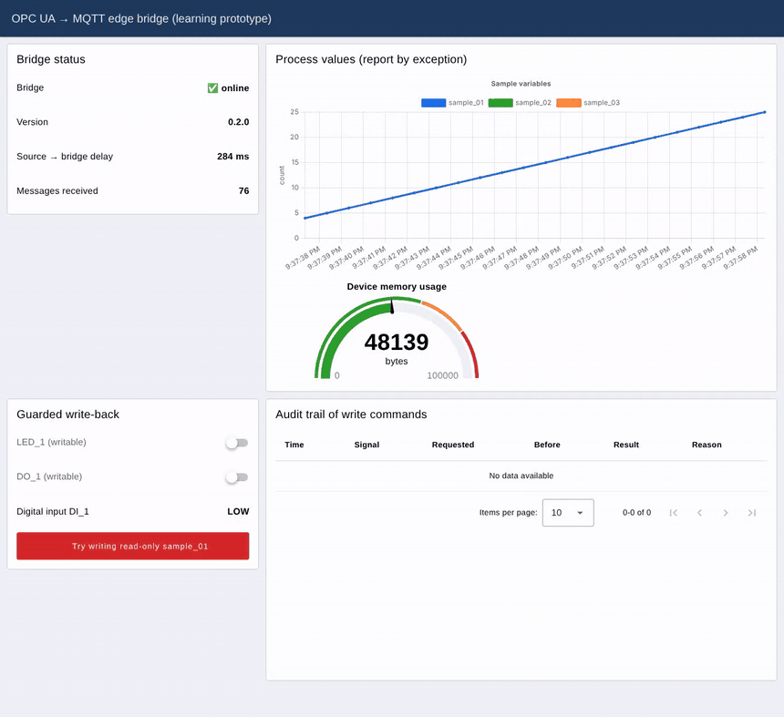

# opcua-edge-bridge

[](https://codespaces.new/ARAVINDPM/opcua-edge-bridge?quickstart=1)
[](https://github.com/ARAVINDPM/opcua-edge-bridge/actions/workflows/ci.yml)

**Learning prototype.** Reads data from an OPC UA server on an industrial device and publishes it to MQTT, with a guarded write-back path. Built around an STM32 NUCLEO-H753ZI evaluation board running an embedded OPC UA SDK demo, developed first against a **simulator** of that demo.

> Status: bridge, simulator, tests and tools run. **Validation on the physical board is pending** (see `docs/HARDWARE_RUNBOOK.md`). Built with AI-assisted coding (Claude Code); design decisions, review, tests and documentation are mine.

## Why this exists

At embedded world 2026 in Nuremberg I talked with exhibitors about OPC UA and the impact of AI on embedded products, and came home with an OPC UA evaluation board. Two observations from the fair shaped this project:

1. **Security and lifecycle obligations are becoming part of the product.** With the EU Cyber Resilience Act, manufacturers must handle vulnerabilities and ship security updates for a declared support period. Secure defaults and an SBOM are moving from "nice to have" to baseline.
2. **Vendors are experimenting with how to charge for that lifecycle**: per device per month, one-off lifetime licences, usage-based pricing, free tiers with paid upgrades.

So the question behind this repo is a product question, not only a coding exercise:

> *What does a small, trustworthy bridge from OT data (OPC UA) to IT/cloud consumers (MQTT) need, and how would its lifecycle be secured and paid for?*

The product thinking is in [`docs/PRODUCT_NOTES.md`](docs/PRODUCT_NOTES.md).

## What it does

```
OPC UA server (board or simulator) --subscription--> bridge --MQTT--> consumers (Node-RED, SCADA, cloud)
             ^                                          |
             '------- guarded write (allow-list) <------'  factory/<site>/<device>/cmd/<signal>
```

- **Subscription, not polling.** Uses OPC UA monitored items.
- **Report by exception.** Publishes on change beyond a per-signal deadband, plus a heartbeat so "unchanged" can be told apart from "stale".
- **Stateful topics.** A retained `.../state` message plus an MQTT Last Will show consumers whether the bridge is alive. The idea is borrowed from Sparkplug B's birth/death concept, without the Protobuf payload.
- **Payload** (JSON): `signal`, `value`, `source_ts`, `bridge_ts`, `quality`, `seq`.
- **Least-privilege write-back.** Only signals marked `writable` accept commands. Payloads are type-checked.
- **Audit trail.** Every command is recorded in `logs/audit.jsonl` and on `.../audit`. Each record holds the requested value, the value before the write and the result (`written`, `rejected` or `failed`).
- **Tools**
  - `tools/security_report.py` lists the server's endpoints and security policies and flags weak defaults (the `None` policy, anonymous login, deprecated policies).
  - `tools/pricing_model.py` is a toy model comparing four ways to pay for lifelong updates. All numbers are hypothetical.

## Live demo (one command)

**Without installing anything:** click *Open in GitHub Codespaces* above (a free GitHub account is enough). The container installs everything and starts the demo, then the dashboard opens in a new browser tab. It takes about 2–3 minutes the first time.

**Locally:**

```bash
python3 -m venv .venv && .venv/bin/pip install -r requirements-dev.txt
./scripts/demo.sh            # or: make demo
```

This starts an MQTT broker (Mosquitto if installed, otherwise Docker or the Python broker amqtt), the OPC UA simulator, a Node-RED dashboard and the bridge, then opens <http://localhost:1880/dashboard> (the Node-RED editor is at `/editor`). Ctrl+C stops everything. Needs Python 3.10+ and Node.js 18+; on macOS: `brew install node mosquitto`.



What the dashboard shows:
- **Bridge status:** birth/death state from the retained `.../state` topic. Kill the bridge and it turns to OFFLINE via the MQTT Last Will. It also shows the source-to-bridge delay and the message count.
- **Process values:** the sample counters and the device memory usage, published only on change.
- **Guarded write-back:** LED_1 and DO_1 are writable. The red button tries to write a read-only signal, which the bridge rejects.
- **Audit trail:** every write command, accepted or rejected, with the value before and after. It is also stored in `logs/audit.jsonl`.

A walkthrough for presenting it is in [`docs/DEMO_SCRIPT.md`](docs/DEMO_SCRIPT.md).

## Quick start (simulator, no hardware)

```bash
pip install -r requirements.txt
python -m sim.eflex_demo_sim &                         # OPC UA simulator on opc.tcp://127.0.0.1:4842
python -m bridge.main --config config/sim.json --dry-run --seconds 5
python -m tools.security_report --endpoint opc.tcp://127.0.0.1:4842
python -m tools.pricing_model
pytest -q                                              # 18 tests incl. end-to-end with the simulator
```

With a real broker: `docker compose up -d mosquitto`, then run without `--dry-run`. Toggle the LED:
`mosquitto_pub -t factory/lab/nucleo-h753zi/cmd/led_1 -m '{"value": true}'`

## Simulator vs. real board

The simulator reproduces the *observable* behaviour of the board demo as described in its quick-start guide:
- 10 sample variables that increment once per second;
- a writable `LED_1`;
- I/O variables;
- a `CreateSetOfVariables` method that adds 50 variables;
- memory usage.

It is not the vendor firmware. Node names and namespace on the board will differ, so use `config/board.template.json` after browsing the board.

Known gap: the board demo offers ECC (`ECC_nistP256`) security. The Python OPC UA stack used here (asyncua 2.1) supports RSA-based policies only, so the bridge connects to the board with security `None` in the lab. See [`docs/SECURITY_NOTES.md`](docs/SECURITY_NOTES.md) for what that means and how a product would close it.

## Repository layout

```
bridge/   core.py (pure logic), bridge.py (OPC UA <-> MQTT), audit.py, mqtt_sink.py, main.py (CLI)
nodered/  Node-RED dashboard (flows.json is generated by gen_flows.py)
scripts/  demo.sh (one-command demo)
sim/      eflex_demo_sim.py (simulator of the board demo)
tools/    security_report.py, pricing_model.py
config/   sim.json, board.template.json
docs/     PRODUCT_NOTES, SECURITY_NOTES, HARDWARE_RUNBOOK, MARKET_NOTES (sources)
tests/    unit + end-to-end tests
sbom.cdx.json  CycloneDX SBOM of the Python dependencies
```

## Limits (honest list)

- Not tested on the physical board yet, and not tested against a production broker or under load.
- No store-and-forward buffer when the broker is offline (listed as the next step).
- No ECC security policy in the client stack. No OPC UA PubSub (Part 14) and no Sparkplug B Protobuf payloads.
- The pricing model uses invented parameters and says nothing about any real company.

MIT licence.
